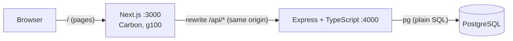
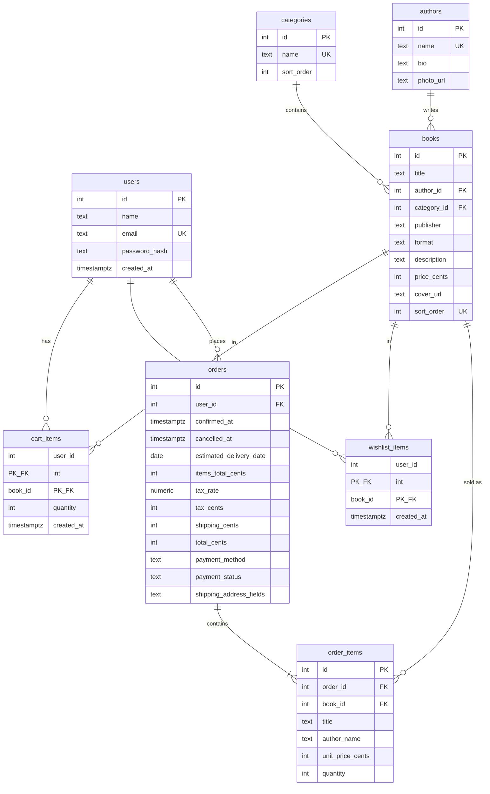

# E-Bookstore PoC – Technical Design

Companion to [`requirements.md`](requirements.md) and [`decisions.md`](decisions.md). Precedence when sources disagree: **`decisions.md` > this document > wireframes**. The wireframes in [`photos/`](photos/) are a visual reference only.

Everything marked **(proposed)** is a default I chose where the sources are silent. Section 12 lists all of them so they can be confirmed or changed before the OpenAPI spec and implementation start.

Contents:

1. Architecture overview
2. Project structure
3. Configuration
4. Data model
5. Business rules and calculations
6. Authentication
7. API design
8. Frontend design
9. Testing plan
10. Implementation phases
11. Wireframe vs. decisions reconciliation
12. Open questions and proposed defaults

---

## 1. Architecture overview



| Concern | Choice |
|---|---|
| Monorepo | `backend/` and `frontend/` as independent npm packages (T1) |
| DB access | `pg` with hand-written SQL and a `Pool`. No ORM (T2) |
| Browser to API | Next.js `rewrites()` proxies `/api/*` to Express **(proposed)**. The browser sees one origin, so no CORS and the `SameSite=Lax` cookie works without extra setup |
| Validation | `zod` on all request bodies and query strings **(proposed)** |
| Password hashing | `bcryptjs`, cost 10 **(proposed)**. It is pure JS, so there are no native build issues locally |
| Money | Integer **cents** everywhere (DB, API, code). Only the UI formats it as EUR |
| Time | All timestamps are `timestamptz` in UTC. The "estimated delivery date" is a `date` |
| Layering (backend) | `routes` → `services` (business rules) → `repositories` (SQL). Pure functions (pricing, status) have no DB access |

---

## 2. Project structure

```text
/
├── docs/
├── backend/
│   ├── package.json
│   ├── tsconfig.json
│   ├── vitest.config.ts
│   ├── .env.example
│   ├── db/
│   │   ├── migrations/          # 001_init.sql, ...
│   │   └── seed/                # seed data (TS or JSON) + seed script
│   ├── scripts/                 # migrate.ts, seed.ts, reset.ts
│   └── src/
│       ├── app.ts               # builds the Express app (used by Supertest)
│       ├── server.ts            # listen()
│       ├── config.ts            # typed env config
│       ├── db.ts                # pg Pool + tx helper
│       ├── middleware/          # auth (required/optional), error handler, validate
│       ├── modules/
│       │   ├── auth/
│       │   ├── catalogue/       # books, categories, authors, related
│       │   ├── recommendations/
│       │   ├── cart/
│       │   ├── wishlist/
│       │   └── orders/          # checkout, history, cancel, buy-again
│       └── lib/                 # pricing.ts, orderStatus.ts, errors.ts
└── frontend/
    ├── package.json
    ├── next.config.mjs          # rewrites /api/* → backend
    ├── middleware.ts            # redirect guests from protected routes
    ├── public/covers/           # placeholder cover images
    └── src/
        ├── app/                 # App Router pages (section 8)
        ├── components/          # BookCard, BookGrid, QuantityStepper, ...
        ├── lib/                 # api client, money/date formatters, types
        └── styles/              # Carbon g100 theme (Sass)
```

Each module under `backend/src/modules/*` holds `routes.ts`, `service.ts`, `repository.ts` and `schemas.ts`. Tests sit next to the code as `*.test.ts`.

---

## 3. Configuration

Backend `.env` (documented in `.env.example`):

| Variable | Default | Notes |
|---|---|---|
| `PORT` | `4000` | |
| `DATABASE_URL` | `postgres://localhost:5432/bookworm` | |
| `TEST_DATABASE_URL` | `postgres://localhost:5432/bookworm_test` | Used by API tests |
| `JWT_SECRET` | none (required) | Fail at startup if missing |
| `JWT_EXPIRES_IN` | `1h` | A3 |
| `DELIVERY_DAYS` | `5` | C9. Must be **≥ 3**, see section 5.3 |
| `SHIPPING_COST_CENTS` | `0` | K5 (free) |
| `TAX_RATE` | `0.09` | K4. The value is **proposed**, see Q3 |
| `CANCELLATION_WINDOW_HOURS` | `48` | O4. Kept as a config constant |

Frontend: `BACKEND_URL` (default `http://localhost:4000`), used only by the `next.config.mjs` rewrite.

npm scripts (both packages where relevant): `dev`, `build`, `test`, `lint`. Backend only: `db:migrate`, `db:seed`, `db:reset` (drop, migrate, seed).

---

## 4. Data model

### 4.1 ER diagram



`shipping_address_fields` is shorthand for the 8 `shipping_*` columns shown in the DDL.

### 4.2 DDL (PostgreSQL) – `001_init.sql`

```sql
CREATE TABLE users (
  id            integer GENERATED ALWAYS AS IDENTITY PRIMARY KEY,
  name          text        NOT NULL CHECK (length(btrim(name)) > 0),
  email         text        NOT NULL,                 -- stored lower-cased by the app
  password_hash text        NOT NULL,
  created_at    timestamptz NOT NULL DEFAULT now()
);
CREATE UNIQUE INDEX users_email_key ON users (lower(email));

CREATE TABLE categories (
  id         integer GENERATED ALWAYS AS IDENTITY PRIMARY KEY,
  name       text    NOT NULL UNIQUE,
  sort_order integer NOT NULL DEFAULT 0
);

CREATE TABLE authors (
  id        integer GENERATED ALWAYS AS IDENTITY PRIMARY KEY,
  name      text NOT NULL UNIQUE,
  bio       text,                                     -- "About the writer" on the product page
  photo_url text
);

CREATE TABLE books (
  id          integer GENERATED ALWAYS AS IDENTITY PRIMARY KEY,
  title       text    NOT NULL,
  author_id   integer NOT NULL REFERENCES authors(id)    ON DELETE RESTRICT,
  category_id integer NOT NULL REFERENCES categories(id) ON DELETE RESTRICT,  -- C1: exactly one
  publisher   text    NOT NULL,                       -- C2: plain text only
  format      text    NOT NULL CHECK (format IN ('Paperback', 'Hardcover')),  -- S1
  description text    NOT NULL,                       -- one text, used on cards and product page
  price_cents integer NOT NULL CHECK (price_cents > 0),
  cover_url   text    NOT NULL,
  sort_order  integer NOT NULL UNIQUE                 -- "Relevance" = seed order (C5)
);
CREATE INDEX books_category_idx ON books (category_id);
CREATE INDEX books_author_idx   ON books (author_id);

-- K1: server-side cart. One row per (user, book); the cart itself needs no table.
CREATE TABLE cart_items (
  user_id    integer     NOT NULL REFERENCES users(id) ON DELETE CASCADE,
  book_id    integer     NOT NULL REFERENCES books(id) ON DELETE RESTRICT,
  quantity   integer     NOT NULL CHECK (quantity > 0),   -- 0 = row is deleted (K3)
  created_at timestamptz NOT NULL DEFAULT now(),
  PRIMARY KEY (user_id, book_id)
);

-- W1
CREATE TABLE wishlist_items (
  user_id    integer     NOT NULL REFERENCES users(id) ON DELETE CASCADE,
  book_id    integer     NOT NULL REFERENCES books(id) ON DELETE RESTRICT,
  created_at timestamptz NOT NULL DEFAULT now(),
  PRIMARY KEY (user_id, book_id)
);

CREATE TABLE orders (
  id                      integer GENERATED ALWAYS AS IDENTITY PRIMARY KEY,
  user_id                 integer       NOT NULL REFERENCES users(id) ON DELETE RESTRICT,

  -- O2: the only stored lifecycle facts. Shipped/Delivered are derived.
  confirmed_at            timestamptz   NOT NULL DEFAULT now(),
  cancelled_at            timestamptz,
  estimated_delivery_date date          NOT NULL,       -- snapshot: confirmed date + DELIVERY_DAYS

  -- Price snapshot (K4, K5, K6). Computed by the backend only.
  items_total_cents       integer       NOT NULL CHECK (items_total_cents >= 0),
  tax_rate                numeric(5,4)  NOT NULL,
  tax_cents               integer       NOT NULL CHECK (tax_cents >= 0),   -- already INCLUDED in items_total
  shipping_cents          integer       NOT NULL CHECK (shipping_cents >= 0),
  total_cents             integer       NOT NULL,

  -- P3, P4: no card data
  payment_method          text          NOT NULL CHECK (payment_method IN ('credit_card', 'debit_card')),
  payment_status          text          NOT NULL CHECK (payment_status IN ('paid', 'refunded')),

  -- K7, K8: address snapshot, all required
  shipping_first_name     text NOT NULL,
  shipping_last_name      text NOT NULL,
  shipping_phone          text NOT NULL,
  shipping_address        text NOT NULL,
  shipping_city           text NOT NULL,
  shipping_postal_code    text NOT NULL,
  shipping_state          text NOT NULL,
  shipping_country        text NOT NULL,

  CONSTRAINT orders_total_ck  CHECK (total_cents = items_total_cents + shipping_cents),
  CONSTRAINT orders_cancel_ck CHECK ((cancelled_at IS NULL) = (payment_status = 'paid'))
);
CREATE INDEX orders_user_idx ON orders (user_id, confirmed_at DESC);

CREATE TABLE order_items (
  id               integer GENERATED ALWAYS AS IDENTITY PRIMARY KEY,
  order_id         integer NOT NULL REFERENCES orders(id) ON DELETE CASCADE,
  book_id          integer NOT NULL REFERENCES books(id)  ON DELETE RESTRICT,  -- needed for Buy Again / recommendations
  title            text    NOT NULL,   -- snapshot
  author_name      text    NOT NULL,   -- snapshot
  unit_price_cents integer NOT NULL CHECK (unit_price_cents > 0),  -- snapshot
  quantity         integer NOT NULL CHECK (quantity > 0),
  UNIQUE (order_id, book_id)
);
```

Notes on the model:

- **No `payments` table.** P3 says the order stores only method and status. One order has exactly one mock payment, so two columns on `orders` are enough.
- **No `stock` column and no `carts` table.** See S9 and K1.
- **`order_items` snapshots** title, author name and unit price, so order history stays correct if seed data changes. Cover, format and category are read by joining `books`. Books are never deleted (`ON DELETE RESTRICT`).
- **`orders_cancel_ck`** makes `cancelled_at` and `payment_status = 'refunded'` always change together.
- **`sort_order` on `categories` and `books`** gives deterministic seed order. Sorting by `price`/`title` always adds `id` as a tie-breaker.
- **Migrations** are plain numbered `.sql` files applied in order by `scripts/migrate.ts`. It records applied files in a `schema_migrations` table **(proposed)**.

### 4.3 Seed data (C3, A5)

| Entity | Quantity | Notes |
|---|---|---|
| Categories | 8–10 | Taken from the wireframe sidebar, e.g. Romance, Mystery, Science Fiction, Fantasy, Self-help, Biography, Cooking, Children's, Poetry, Science |
| Authors | ~10 | Wireframe names (Daniel Reed, James Wright, Arjun Patel, Raj Patel, James Adams, Jessica Martin, Laura Mitchell, Clara Nelson, Emily Parker) plus fill-ins. All have a short `bio`, `photo_url` optional |
| Books | 30–40 | Mix of Paperback and Hardcover. Prices in EUR cents. Fixed `sort_order` |
| Demo user | 1 | `demo@bookworm.local` / `demo12345` **(proposed)**. No order history, so the empty-state of recommendations is visible. An optional second seeded order would help demo the history, see Q14 |

The wireframe sidebar contains genres that overlap with its "Non-fiction / Self Help" tags (see section 11). In the seed, each book gets **one** category only.

---

## 5. Business rules and calculations

### 5.1 Pricing (K4–K6)

All of this lives in one pure function, `lib/pricing.ts`, used by both `GET /api/cart` and checkout.

```text
itemCount     = Σ quantity
itemsTotal    = Σ (unitPriceCents × quantity)          // tax already included
taxIncluded   = round(itemsTotal × r / (1 + r))        // r = TAX_RATE; Math.round, half up
shipping      = SHIPPING_COST_CENTS
total         = itemsTotal + shipping                  // NOT + tax
```

- The UI shows "Price (N items)", "Includes €X tax", "Delivery charges: Free / €X" and "Total". The wireframe's Discount and Coupon rows are removed (S7).
- "N items" is the **sum of quantities** **(proposed)**. The cart badge uses the same number.
- A checkout takes prices from the DB at checkout time, never from the client.

### 5.2 Delivery estimate (C9)

`estimatedDeliveryDate = (today in UTC) + DELIVERY_DAYS`. It is computed on each request for catalogue and cart responses. At checkout it is **frozen** into `orders.estimated_delivery_date`.

### 5.3 Order status (O2)

Status is derived by a pure function and never stored, except cancellation. The clock is passed in so the function is easy to test.

```ts
type OrderStatus = 'Confirmed' | 'Shipped' | 'Delivered' | 'Cancelled';

function deriveOrderStatus(o: { confirmedAt: Date; cancelledAt: Date | null;
                                estimatedDeliveryDate: string /* YYYY-MM-DD */ }, now: Date): OrderStatus {
  if (o.cancelledAt) return 'Cancelled';
  const hours = (now.getTime() - o.confirmedAt.getTime()) / 36e5;
  if (hours < 48) return 'Confirmed';
  // "after the estimated delivery date" = from 00:00 UTC of the following day (proposed)
  const deliveredFrom = Date.parse(o.estimatedDeliveryDate + 'T00:00:00Z') + 24 * 36e5;
  return now.getTime() < deliveredFrom ? 'Shipped' : 'Delivered';
}
```

- `cancellable = status === 'Confirmed'`. This is the same condition as "within 48 h and not cancelled", so there is one rule only.
- **Constraint:** `DELIVERY_DAYS` must be ≥ 3. With 1–2 days the delivery date would fall inside the 48 h window and "Shipped" would be skipped or inverted. Validate at startup.
- The window is `[confirmed_at, confirmed_at + 48 h)`, with the end exclusive.

### 5.4 Checkout (K2, K6–K8, P1)

`POST /api/orders` runs in **one DB transaction**:

1. Lock and read the user's `cart_items` joined with `books`. If empty, respond `409 CART_EMPTY`.
2. Validate the address and `paymentMethod`.
3. Compute pricing (5.1) from current DB prices.
4. Insert `orders` with `payment_status = 'paid'` and `estimated_delivery_date`.
5. Insert `order_items` (with snapshots).
6. Delete the user's `cart_items`.
7. Commit and return the order detail (201).

The mock payment always succeeds (P1), so there is no `pending` or `failed` state and **no order exists unless it is paid**. If any step throws, nothing is written and the cart is untouched.

### 5.5 Cancellation (O4)

A single atomic statement avoids races and a check-then-update gap:

```sql
UPDATE orders
   SET cancelled_at = now(), payment_status = 'refunded'
 WHERE id = $1 AND user_id = $2
   AND cancelled_at IS NULL
   AND now() < confirmed_at + make_interval(hours => $3)
RETURNING *;
```

If no row is returned, the service looks up the order. If it does not exist or belongs to someone else, respond `404`. Otherwise respond `409 CANCELLATION_NOT_ALLOWED` with a message that says why (already cancelled or window expired).

### 5.6 Buy Again (O5)

For each item of the order, in one transaction:

```sql
INSERT INTO cart_items (user_id, book_id, quantity)
VALUES ($1, $2, $3)
ON CONFLICT (user_id, book_id)
DO UPDATE SET quantity = cart_items.quantity + EXCLUDED.quantity;
```

It uses the original quantity. It works for any order status, including Cancelled. Returns the updated cart.

### 5.7 Search, filter, sort (C4–C6)

- `q`: `title ILIKE '%q%' OR author.name ILIKE '%q%'`. `%`, `_` and `\` in user input are escaped. The term is trimmed, and an empty term is ignored.
- `categoryId` and `authorId` are combined with `q` using AND.
- `sort` is a whitelist mapped to fixed `ORDER BY` fragments (never string-interpolated from input):

| `sort` | ORDER BY |
|---|---|
| `relevance` (default) | `books.sort_order` |
| `price_asc` | `price_cents, id` |
| `price_desc` | `price_cents DESC, id` |
| `title_asc` | `lower(title), id` |

### 5.8 Related books (C7)

```sql
SELECT ... FROM books
 WHERE category_id = (SELECT category_id FROM books WHERE id = $1) AND id <> $1
 ORDER BY sort_order LIMIT 4;
```

### 5.9 Recommendations (C8)

For a logged-in user with at least one order (cancelled orders are included **(proposed)**, because the interest signal is the same):

```sql
SELECT b.* FROM books b
 WHERE b.category_id IN (SELECT DISTINCT b2.category_id
                           FROM order_items oi
                           JOIN orders o ON o.id = oi.order_id AND o.user_id = $1
                           JOIN books  b2 ON b2.id = oi.book_id)
   AND b.id NOT IN (SELECT oi.book_id FROM order_items oi
                      JOIN orders o ON o.id = oi.order_id AND o.user_id = $1)
 ORDER BY b.sort_order
 LIMIT 10;
```

If the result is empty (no history, or everything in those categories is already bought), fall back to the first 10 books by `sort_order`. This is also what guests get.

---

## 6. Authentication

| Item | Decision |
|---|---|
| Register | `name` (1–100 chars), `email` (valid format, stored lower-cased, unique), `password` (≥ 8 chars, max 72 because of bcrypt). After registering the user is **logged in automatically** **(proposed)** |
| Token | JWT `HS256`, payload `{ sub: userId }`, expiry `1h`. No refresh token (A3) |
| Cookie | Name `token`. `httpOnly`, `SameSite=Lax`, `Path=/`, `Max-Age=3600`, `Secure` only when `NODE_ENV=production` |
| Logout | `POST /api/auth/logout` clears the cookie. The JWT is stateless, so there is no server-side revocation (accepted for PoC) |
| Middleware | `requireAuth`: 401 if the cookie is missing or invalid. `optionalAuth`: attaches the user if present, otherwise continues as guest. Used by `recommendations` and book detail |
| CSRF | `SameSite=Lax` plus the rule that every state-changing endpoint is `POST/PUT/DELETE` with a JSON body. No CSRF tokens in the PoC |
| Login errors | One generic `INVALID_CREDENTIALS` for both unknown email and wrong password |
| Guest redirect (A4) | Next.js `middleware.ts` redirects `/cart`, `/wishlist`, `/orders/**` to `/login?next=<path>` when the `token` cookie is absent. If an API call returns 401 (expired token), the client also redirects to `/login?next=...` |
| Guest actions | "Add to Cart" or "Add to Wishlist" clicked by a guest redirects to `/login?next=<current page>` **(proposed)** |

---

## 7. API design

Base path `/api`, JSON only, no versioning (S13), no pagination (S12). Ids are integers. Dates are ISO 8601 (`YYYY-MM-DD` for dates, full UTC timestamp for instants). Money fields end in `Cents`.

### 7.1 Error format

```json
{ "error": { "code": "VALIDATION_ERROR", "message": "Invalid request",
             "details": [ { "field": "address.postalCode", "message": "Required" } ] } }
```

`details` is present only for validation errors.

| HTTP | `code` | When |
|---|---|---|
| 400 | `VALIDATION_ERROR` | Bad body, query or path param |
| 401 | `UNAUTHENTICATED` | Missing, invalid or expired token |
| 401 | `INVALID_CREDENTIALS` | Login failed |
| 404 | `NOT_FOUND` | Unknown resource, **or an order that belongs to another user** |
| 409 | `EMAIL_TAKEN` | Registration with an existing email |
| 409 | `CART_EMPTY` | Checkout with an empty cart |
| 409 | `CANCELLATION_NOT_ALLOWED` | Order not cancellable |
| 500 | `INTERNAL_ERROR` | Unexpected. Details are logged, never returned |

### 7.2 Endpoints

| Method | Path | Auth | Purpose |
|---|---|---|---|
| POST | `/auth/register` | – | Create account, set cookie. 201 `{ user }` |
| POST | `/auth/login` | – | Set cookie. 200 `{ user }` |
| POST | `/auth/logout` | – | Clear cookie. 204 |
| GET | `/auth/me` | required | Current user `{ user }` |
| GET | `/categories` | – | `{ items: [{id, name}] }` ordered by `sort_order` |
| GET | `/authors` | – | `{ items: [{id, name}] }` ordered by name (filter dropdown) |
| GET | `/books` | – | Query: `q`, `categoryId`, `authorId`, `sort`. `{ items: Book[] }` |
| GET | `/books/:id` | optional | `BookDetail` |
| GET | `/books/:id/related` | – | `{ items: Book[] }` (max 4) |
| GET | `/recommendations` | optional | `{ items: Book[] }` (max 10) |
| GET | `/cart` | required | `Cart` |
| POST | `/cart/items` | required | Body `{ bookId, quantity? = 1 }`. Adds or increments. Returns `Cart` |
| PUT | `/cart/items/:bookId` | required | Body `{ quantity }`. `0` removes the item. Returns `Cart` |
| GET | `/wishlist` | required | `{ items: Book[] }` newest first |
| POST | `/wishlist/items` | required | Body `{ bookId }`. Idempotent. Returns `{ items }` |
| DELETE | `/wishlist/items/:bookId` | required | Idempotent. 204 |
| POST | `/wishlist/items/:bookId/move-to-cart` | required | Adds 1 to the cart and removes from the wishlist, in one transaction. Returns `Cart` |
| POST | `/orders` | required | **Checkout + mock payment.** Body below. 201 `Order` |
| GET | `/orders` | required | `{ items: OrderSummary[] }`, newest first |
| GET | `/orders/:id` | required | `Order` |
| POST | `/orders/:id/cancel` | required | Returns `Order` |
| POST | `/orders/:id/buy-again` | required | Returns `Cart` |

Route order matters: `/books/:id/related` and `/wishlist/items/:bookId/move-to-cart` must not be shadowed by simpler patterns.

### 7.3 Main DTOs

```ts
Book = {
  id, title, description, format: 'Paperback' | 'Hardcover',
  priceCents, coverUrl, publisher,
  author:   { id, name },
  category: { id, name },
  estimatedDeliveryDate: 'YYYY-MM-DD'
}

BookDetail = Book & {
  author: { id, name, bio: string | null, photoUrl: string | null },
  inWishlist: boolean            // false for guests
}

Cart = {
  items: [{ book: Book, quantity, lineTotalCents }],
  itemCount,                     // sum of quantities
  itemsTotalCents,
  taxIncludedCents,
  shippingCents,
  totalCents
}

CheckoutRequest = {
  paymentMethod: 'credit_card' | 'debit_card',
  address: { firstName, lastName, phone, address, city, postalCode, state, country }   // all required
}

Order = {
  id, status: OrderStatus, cancellable: boolean,
  confirmedAt, cancelledAt: string | null, estimatedDeliveryDate,
  paymentMethod, paymentStatus: 'paid' | 'refunded',
  address: { ...same 8 fields },
  items: [{ book: Book, title, authorName, unitPriceCents, quantity }],
  itemCount, itemsTotalCents, taxIncludedCents, shippingCents, totalCents
}

OrderSummary = { id, status, confirmedAt, totalCents, itemCount, items: [{ bookId, title, coverUrl, quantity }] }
```

Card number, CVV, expiry and name on card are **not** part of `CheckoutRequest`. See Q6.

### 7.4 Validation rules

| Field | Rule |
|---|---|
| `name` | trimmed, 1–100 chars |
| `email` | valid format, ≤ 254 chars, lower-cased |
| `password` | 8–72 chars |
| address text fields | trimmed, 1–100 chars. `address` up to 200 |
| `phone` | `^\+?[0-9 ()-]{6,20}$` |
| `postalCode` | 1–20 chars. No country-specific format (K8: "basic validation") |
| `quantity` (add) | integer 1–999 **(proposed technical guard, not a business limit, see Q9)** |
| `quantity` (set) | integer 0–999 |
| `q` | ≤ 100 chars |
| `sort` | one of the four whitelisted values, otherwise 400 |

---

## 8. Frontend design

### 8.1 Pages

| Route | Page | Access | Wireframe |
|---|---|---|---|
| `/` | Catalogue: category sidebar, search, filters, sort, Recommended for You, book grid | public | `catalogue.png` |
| `/books/[id]` | Product page | public | `payment_and_purchase.png` (the file name does not match its content, see Q16) |
| `/login`, `/register` | Auth forms | public | none (A1) |
| `/cart` | Cart + address + totals + Pay Now (single screen, K2) | login | `shopping_cart.png` |
| *(modal on `/cart`)* | Payment dialog | login | `payment_screen.png` |
| `/orders/[id]/confirmation` | Purchase confirmation | login | `payment_confirmation.png` |
| `/orders` | Order history with Buy Again | login | none |
| `/orders/[id]` | Order detail, status, Cancel | login | none (O3) |
| `/wishlist` | Wishlist with Remove and Move to cart | login | none |

### 8.2 Header

`Book Worm` logo, **My Orders**, **My Wishlist** (**My Writers** is removed, S8), cart icon with badge (item count), user menu (name and Logout). Guests see **Log in / Register** instead of the user menu. Cart badge is hidden for guests.

### 8.3 Catalogue page (`/`)

- **Left sidebar:** "All" plus categories. The selected category is a query param (`/?categoryId=3`).
- **Toolbar:** Search, **Author** dropdown, Sort by. The wireframe's Language, Format and Price Range are removed (S3, S1, C6). Author takes one of the freed slots **(proposed)**.
- **Default view** (no search, category or author selected): a **Recommended for You** row (up to 10), then the full grid titled "All books". The wireframe's Bestsellers and New Launches rows are removed (S8).
- **Filtered view:** any search, category or author selection hides the Recommended row and shows only the result grid, with an empty state "No books found".
- **Book card:** cover, title, author link (filters the catalogue by that author, C2), short description, format, category tag, price, "Delivery by Mon, 21 Jul".
- State lives in the URL query (`q`, `categoryId`, `authorId`, `sort`), so reload and back button work.

### 8.4 Product page

Breadcrumb `Home / <Category> / <Title>` (C10). Cover, title, author link, description, "Published by <publisher>" (plain text), format, category tag, price, delivery date, **Add to Cart**, **Add to Wishlist / Remove from Wishlist**, "About the writer" (photo and bio), and **Related Reads** (max 4, right column). Removed from the wireframe: Language, Rating, "copies sold", Reviews (S3, S8).

### 8.5 Cart and checkout (`/cart`)

- Breadcrumb `Home / Checkout` **(proposed)**. The wireframe's four-level trail does not match C10.
- **Items:** cover, title, author, description, format, category, price, delivery date, quantity stepper. Setting 0 removes the item. There is no separate remove button. Every change calls `PUT /cart/items/:bookId` and the UI renders the returned `Cart` (K6).
- **Address form (K8):** First name, Last name, Phone, Address, City, Postal code, State, Country. The wireframe's "Use Saved Address", e-mail, phone country-code selector and Address Line 2 are removed (K7, S2).
- **Grand Total:** Price (N items), "Includes €X tax", Delivery charges (Free or €X), Total, **Pay Now**. The Coupon and Discount rows are removed (S7).
- **Pay Now:** validates the address form client-side. If valid, it opens the **Payment dialog**.
- **Empty cart:** message with a link back to the catalogue. The address form and Pay Now are hidden.

### 8.6 Payment dialog

"Complete Payment" with "Payable amount: €X" (`cart.totalCents`). Two vertical tabs: **Credit Card** and **Debit Card** (P2). Fields: Card Number, Name on Card, CVV, Date of Expiry, and **Pay Now**. On submit the client calls `POST /api/orders` with the method and the address, then navigates to `/orders/:id/confirmation`. The card fields are never sent (P3, see Q6). A server error is shown inline in the dialog.

### 8.7 Confirmation

Success icon, "Your purchase of the following reads is successful", the purchased items (cover, title, author, description, format, categories, price, delivery by date), and **Continue your Shopping** (to `/`). The page loads the order via `GET /orders/:id`, so a refresh still works. Showing order number, status and totals here is optional **(proposed: show order number only)**.

### 8.8 Orders

- **History:** one row or tile per order: order number, date, status tag, total, item thumbnails, **View** and **Buy Again**. Buy Again calls the API and navigates to `/cart`.
- **Detail:** items, address, totals (same breakdown as the cart), status tag, payment status, estimated delivery date, **Cancel order** (shown only if `cancellable`, with a confirmation modal). After cancelling, the page shows Cancelled and "Payment refunded".
- Status colours (Carbon tags): Confirmed = blue, Shipped = purple, Delivered = green, Cancelled = gray **(proposed)**.

### 8.9 Frontend technical rules

- Next.js **App Router**, TypeScript, `@carbon/react`, Sass for Carbon tokens. Pages that use Carbon interactive components are client components.
- Theme: Carbon `g100` applied at the root via `<Theme theme="g100">` (T3). The Carbon grid breakpoints drive responsiveness.
- Data fetching is **client-side** through one typed `lib/api.ts` wrapper using `fetch` with same-origin cookies **(proposed)**. SSR is not needed for the PoC and avoids forwarding cookies from the Next server. The wrapper turns the error format into a typed `ApiError` and handles 401 by redirecting to login.
- Formatting: `Intl.NumberFormat('en-IE', { style: 'currency', currency: 'EUR' })`. Dates with `Intl.DateTimeFormat('en-GB', { weekday: 'short', day: 'numeric', month: 'short' })`.
- Cart state (badge count) is held in a small React context refreshed after every cart or checkout response. No state library.
- Loading, empty and error states exist for every list and page. Carbon `InlineNotification` is used for errors and success messages.
- Cover images are static files under `public/covers/` **(proposed)**, and the DB stores a path such as `/covers/joy-of-minimalism.png`. Plain `` or `next/image` with local files only.
- Accessibility: Carbon defaults, labelled inputs, visible focus, alt text on covers.

---

## 9. Testing plan (T4)

Vitest in both packages. Supertest for API tests, React Testing Library for components. No E2E, no coverage target.

### 9.1 Backend

| Area | Type | Cases |
|---|---|---|
| `pricing.ts` | unit | tax rounding, shipping added to total but tax not, quantity sums, zero shipping |
| `orderStatus.ts` | unit | boundaries at 47 h 59 m / 48 h, Shipped before and after delivery day, Delivered from the day after, Cancelled overrides all |
| search/sort builders | unit | wildcard escaping, whitelist rejects unknown `sort` |
| Auth | API | register (ok, duplicate email, short password), login (ok, bad credentials), `me` with and without cookie, expired token, logout clears cookie |
| Catalogue | API | list, search by title and author (case-insensitive), category and author filters, each sort, detail 404, related (same category, excludes self, max 4) |
| Recommendations | API | guest gets first 10; user with history gets same categories and excludes bought books; fallback when none left |
| Cart | API | requires auth, add, add again increments, set quantity, set 0 removes, unknown book 404, totals correct |
| Checkout | API | success creates order and items and clears the cart, snapshot prices, empty cart 409, invalid address 400, rollback on failure |
| Cancellation | API | within 48 h ok (status Cancelled, payment refunded), after 48 h 409, second cancel 409, other user's order 404 |
| Buy Again | API | adds items, increments existing quantity |
| Wishlist | API | add idempotent, remove, move to cart |

API tests run against a **separate local PostgreSQL database** (`TEST_DATABASE_URL`) that is migrated once and truncated between tests **(proposed)**. Time-sensitive tests insert orders with explicit `confirmed_at` values instead of mocking the DB clock.

### 9.2 Frontend

| Component or flow | Cases |
|---|---|
| `QuantityStepper` | increments, decrements, 0 triggers remove |
| `BookCard` | shows price (EUR format), delivery date, author link |
| Address form | required fields, phone and format validation |
| Cart summary | renders backend totals as given, "Free" when shipping is 0 |
| Payment dialog | tab switch, Pay Now calls API with method and address only, shows server error |
| Order detail | Cancel button visible only when `cancellable`; confirmation modal |
| Route guard (`middleware.ts`) | guest redirected with `next` param |
| Formatters | money and date |

---

## 10. Implementation phases

| # | Phase | Output |
|---|---|---|
| 0 | Review this document and answer the open questions | Approved plan |
| 1 | OpenAPI spec (`docs/openapi.yaml`) from section 7 | Contract |
| 2 | Scaffolding: monorepo, TS, lint, Vitest, config, DB pool, migration and seed scripts, error handler | Both apps start. Migrate and seed work |
| 3 | Auth: register, login, logout, me, middleware (+ tests) | Auth works |
| 4 | Catalogue API: categories, authors, books (search, filter, sort), detail, related (+ tests) | Public API |
| 5 | Frontend shell: Carbon g100 theme, header, login and register pages, route guard | Navigable app |
| 6 | Catalogue UI and product page | Browse and search |
| 7 | Cart API + UI, wishlist API + UI | Add, change and remove items |
| 8 | Checkout API (pricing, transaction), payment dialog, confirmation page (+ tests) | End-to-end purchase |
| 9 | Orders: history, detail, derived status, cancel, Buy Again (+ tests) | Order management |
| 10 | Recommendations, polish, empty and error states, README with run instructions | Done |

Phases 3–4 (backend) and 5 (frontend shell) can be done in parallel.

---

## 11. Wireframe vs. decisions reconciliation

| Wireframe element | Resolution |
|---|---|
| ₹ currency, `+91`, India, "Pin" | EUR. Phone is a single text field. "Pin" is "Postal code". Country is a plain field (S2, Q8) |
| "Language" filter and "Language: English" on product page | Removed (S3) |
| "Format" filter, "eBook" book, format "Hard Cover" / "Hardcover" spelling | No format filter (C6). Only Paperback and Hardcover exist (S1). Normalised spelling: `Hardcover` |
| "Price Range" filter | Removed (C6) |
| Each book shows two tags ("Non-fiction, Self Help"; "Fiction, Thriller, Horror") | One category per book (C1). One tag shown |
| Sidebar mixes genres (Romance...) and top-level groups (Non-fiction / Fiction) | Flat list of categories, no hierarchy (C1) |
| Breadcrumb `Home / Non-Fiction / Self Help / Joy of Minimalism / Checkout` | `Home / Category / Book` on product pages (C10). `Home / Checkout` on the cart |
| "Bestsellers this Month", "New Launches", "My Writers" | Removed (S8). "Recommended for You" kept |
| Reviews, rating stars, "145 copies sold" | Removed (S8) |
| Cart: "Use Saved Address", e-mail field, "Address Line 2" placeholder on the main address input | Removed (K7, K8). Single "Address" field. E-mail comes from the account |
| Cart: Apply Coupon, Discount | Removed (S7) |
| Cart: "Tax ₹62" added next to the price | Tax is included in price. Shown as "Includes €X tax" (K4) |
| Payment tabs: UPI, Wallet | Removed (P2) |
| Cart: no explicit remove button | Quantity 0 removes the item (K3) |
| Product page: ISBN and back cover image | Not modelled. See Q10 |
| Author profile: photo and bio | Modelled on `authors` (see Q11) |
| Payment screen shows a standalone page over illustration | Implemented as a modal dialog on the cart page (Q7) |
| `decisions.md` links to `documentation.md`, which does not exist | Dead link. Likely means this document or `requirements.md`. Fix the link |

---

## 12. Open questions and proposed defaults

None of these block the OpenAPI spec if the proposed defaults are accepted. Items that affect the data model or the API contract are marked **[model]** or **[API]**.

| # | Topic | Question | Proposed default |
|---|---|---|---|
| Q1 | Registration | Auto-login after register, or redirect to login? | Auto-login (cookie set on register) **[API]** |
| Q2 | Demo user | Credentials and whether it has any pre-seeded orders | `demo@bookworm.local` / `demo12345`, no orders |
| Q3 | Tax rate | The wireframe uses ~12% (₹62 on ₹508 included). Which rate for EUR? | `TAX_RATE=0.09`, in config only |
| Q4 | Cart badge and "N items" | Distinct books or sum of quantities? | Sum of quantities |
| Q5 | Payment amount wording | Is "Payable Amount" = `total` (items + shipping)? | Yes |
| Q6 | Card fields | Does the backend receive card number, name, CVV, expiry? "Accepts any input" and P3 suggest no | Not sent. Not validated at all, even empty. Only `paymentMethod` is sent **[API]** |
| Q7 | Payment screen | Separate page or modal on `/cart`? | Modal on the cart page. The order is created only after paying |
| Q8 | Country | Free text or a fixed dropdown (wireframe shows a dropdown)? | Free text, required **[API]** |
| Q9 | Max quantity | K3 says no maximum. Is a technical guard acceptable to stop absurd values? | Validation limit of 999, not shown as a business rule |
| Q10 | Book fields | Are ISBN and a second (back) cover image needed? | No. One `cover_url` and one `description` |
| Q11 | Author data | Wireframe shows author photo and bio. In scope? | Yes, `bio` and `photo_url` on `authors` (nullable) **[model]** |
| Q12 | "Browse by author" | Is a dedicated author page needed, or only the author link/filter? | Filter only: the author link opens `/?authorId=` and the toolbar has an Author dropdown |
| Q13 | Home layout | Show Recommended and the full grid together? | Recommended row + "All books" grid by default. Filters/search show only results |
| Q14 | Demo content | Seed one or two past orders for the demo user to show history, recommendations and Buy Again? | No, keep the seed minimal. A tester can place an order |
| Q15 | Delivery date edge | Is an order Delivered from 00:00 UTC the day **after** the estimated date? Is UTC acceptable for the whole PoC? | Yes and yes |
| Q16 | Wireframes | `payment_and_purchase.png` actually shows the product page. There are no wireframes for login, register, orders, order detail and wishlist | Rename the file to `product_page.png`. Design the missing pages with standard Carbon components |
| Q17 | Wishlist semantics | Does "Move to cart" remove the item from the wishlist? Does adding to cart from the product page affect it? | Move removes it. Normal Add to Cart does not touch the wishlist |
| Q18 | Cancelled orders and recommendations | Should cancelled orders count as history? | Yes, they count |
| Q19 | Order identifier | Show raw integer id to users? | Yes, `#1042`-style display of the integer id |
| Q20 | Libraries | OK to add `zod`, `bcryptjs`, `jsonwebtoken`, `cookie-parser`, `supertest` on the backend? | Yes, nothing else beyond Carbon on the frontend |
| Q21 | Test database | API tests against a real local PostgreSQL test DB, or mocked repositories? | Real test DB (T5 already assumes local Postgres) |
| Q22 | Migrations tool | Custom runner or a library such as `node-pg-migrate`? | Custom ~40-line runner, plain `.sql` files |
| Q23 | Images | Where do cover images come from? | Generated or placeholder files in `frontend/public/covers/`, referenced by path in the seed |
| Q24 | Header user menu | What does the user icon do? | Menu with the user's name and Logout |

### Risks to keep in mind

- **Floating-point money:** avoided by using integer cents everywhere. Do not use `numeric` JS maths for totals.
- **Time-based status in tests:** keep `deriveOrderStatus` pure and pass `now`, so tests do not depend on the real clock.
- **Cookie across ports:** works on `localhost` only because the Next rewrite makes calls same-origin. If the frontend calls Express directly from the browser, CORS with `credentials: true` is needed.
- **Carbon with Next.js App Router:** Carbon components need `"use client"`. Isolating them in client wrapper components avoids server/client boundary errors.
